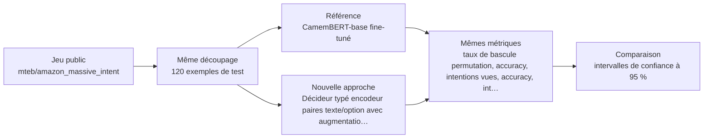
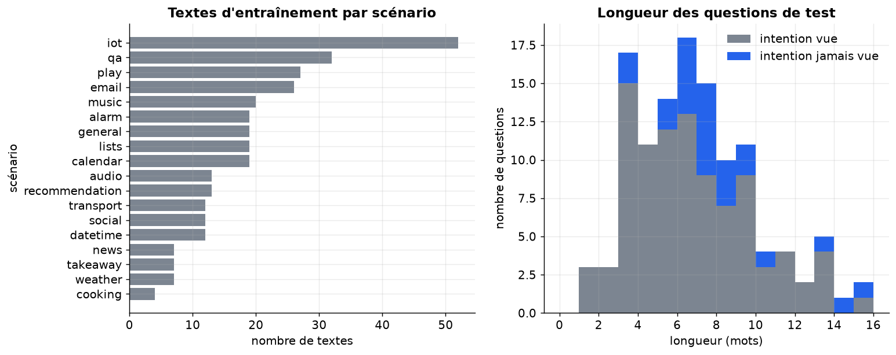
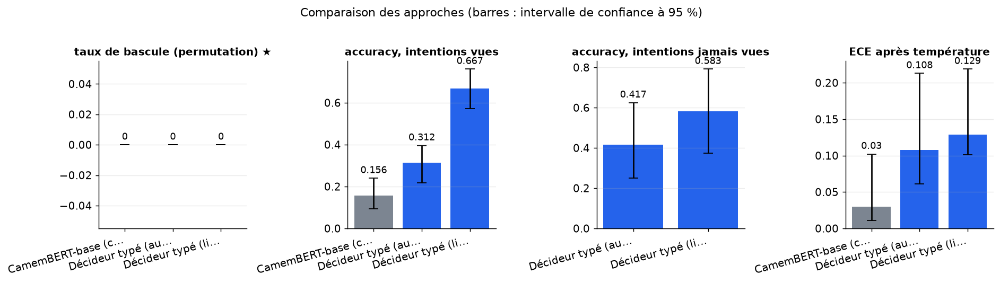
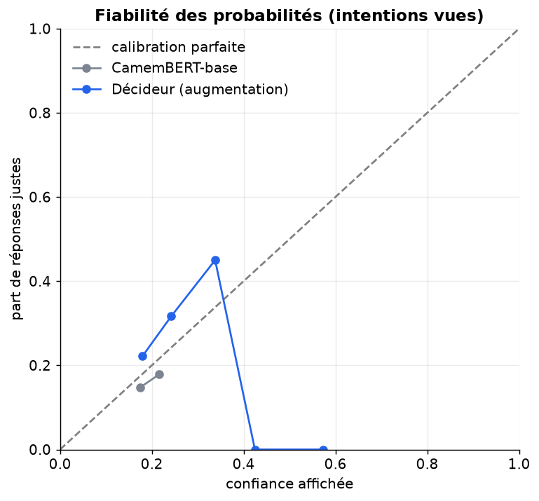
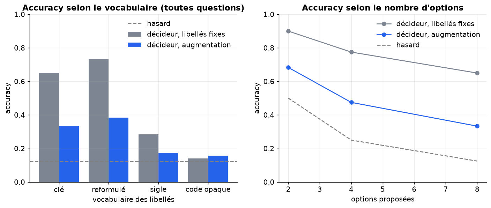

# Un décideur typé entraîné (encodeur de paires texte/option) égale-t-il un CamemBERT à classes fixes en français, et reste-t-il stable quand on change l'ordre, la formulation des libellés et les classes proposées ?

> **En bref.** Verdict impossible à cette échelle : la référence est à peine entraînée et reste au hasard. La stabilité à l'ordre est acquise par construction, donc peu informative sur les modèles de décision de la source. taux de bascule (permutation) : 0 [0 ; 0] pour Décideur typé (libellés fixes), contre 0 [0 ; 0] pour CamemBERT-base (classes fixes) (120 exemples de test, échelle réduite, chiffres indicatifs).

## Sommaire

1. [La question](#la-question)
2. [Le protocole](#le-protocole)
3. [Les résultats](#les-résultats)
4. [Ce qu'il faut retenir](#ce-quil-faut-retenir)
5. [Rejouer l'expérience](#rejouer-lexpérience)
6. [Contenu du dépôt](#contenu-du-dépôt)
7. [Références](#références)
8. [Glossaire](#glossaire)

## La question

On compare deux façons de ranger des requêtes en français parmi une soixantaine de catégories. La première est un classifieur CamemBERT classique, qui apprend une liste de catégories figée. La seconde est un « décideur typé » : il reçoit à chaque fois la liste des options et juge chaque paire (texte, libellé), si bien qu'il peut accepter une catégorie nouvelle ou renommée. On mesure si le décideur est aussi précis, si son choix reste le même quand on mélange les options, s'il reconnaît des catégories jamais vues, et ce qu'il devient quand les libellés sont reformulés, tronqués ou remplacés par des codes sans signification. Le résultat dit si l'on peut faire évoluer une liste de motifs sans réentraîner le modèle, et quel soin il faut apporter à la rédaction des libellés.

**Hypothèse testée.** Un décideur typé encodeur (mmBERT-base, paires texte/option, 60 options) entraîné avec augmentation de libellés atteint une accuracy à au plus 3 points de CamemBERT-base sur les intentions vues, avec un taux de bascule sous permutation inférieur à 5 %, une accuracy supérieure à 50 % sur 10 intentions jamais vues à l'entraînement (impossible pour CamemBERT), mais s'effondre (accuracy proche du hasard, 1/60) sur libellés opaques.

| | Référence | Nouvelle approche |
|---|---|---|
| **Approche** | CamemBERT-base fine-tuné | Décideur typé encodeur (paires texte/option) avec augmentation de libellés |
| **Principe** | Classifieur à classes fixes : encodeur CamemBERT-base avec tête linéaire sur les 50 intentions d'entraînement, entraîné jusqu'à convergence avec sélection sur la validation. | Un encodeur lit chaque paire (texte, libellé de l'option) et produit un score ; un softmax avec température sur les options fournies donne une probabilité par option, sans tête de classes fixes. À l'entraînement, chaque libellé est tiré parmi plusieurs formulations. |
| **Mise en œuvre** | transformers AutoModelForSequenceClassification (almanach/camembert-base), 6 époques à l'échelle complète (1 en réduit), lr 3e-5, batch 32, longueur max 64, meilleur point sur validation. Ordre des options sans effet. Probabilités par softmax, puis mise à l'échelle par température ajustée sur la validation. | mmBERT-base en cross-encoder (transformers AutoModel + tête linéaire sur [CLS]), entraîné en perte softmax sur K=16 options tirées (la bonne + négatifs dont des frères du même scénario), 3 époques à l'échelle complète. Deux variantes : libellés fixes (clé anglaise lisible) et augmentation (clé, mots français séparés, forme tronquée, scénario+intention). Évaluation à 60 options sur plusieurs présentations : 3 ordres (aléatoire, rang, inverse), 4 vocabulaires (clé, mots français, sigle tronqué à 3 lettres, code opaque), et décision en deux temps (scénario puis intention). Température ajustée sur validation. |
| **Modèles** | [`almanach/camembert-base`](https://huggingface.co/almanach/camembert-base) | [`jhu-clsp/mmBERT-base`](https://huggingface.co/jhu-clsp/mmBERT-base) |

## Le protocole



- **Données** : [`mteb/amazon_massive_intent`](https://huggingface.co/datasets/mteb/amazon_massive_intent) (configuration `fr`), évaluation sur le découpage `test` (120 exemples). Seul jeu français chargeable à traduction humaine avec arbre à deux niveaux (18 scénarios, 60 intentions) et libellés textuels, licence apache-2.0 : permet de mesurer cohérence parent/enfant, changement de libellés et classes ajoutées sans réentraînement.
- **Écarts avec des données réelles** : Requêtes courtes d'assistant vocal, hors services financiers ; 60 classes au lieu de ~300 ; classes équilibrées ; pas d'e-mails ni de jargon réel ; vocabulaires de libellés construits par règle (français, tronqué, codes) plutôt que par des experts.
- **Déroulé** : Jeu MASSIVE français (mteb/amazon_massive_intent, config fr) : 10 intentions sur 60, tirées avec la graine, sont retirées de l'entraînement et de la validation. Le test, apparié pour toutes les approches, mélange intentions vues et jamais vues (20 %). CamemBERT-base est fine-tuné à classes fixes (lr 3e-5, lots de 32, meilleure époque retenue sur la validation, température ajustée sur la validation) et choisit parmi les options proposées qu'il connaît. Le décideur mmBERT en cross-encoder est entraîné en perte softmax sur K options, dont des négatifs difficiles, avec ou sans augmentation de libellés. Chaque approche est évaluée sur plusieurs ordres d'options : on en tire le taux de bascule, mesuré de la même façon pour la référence. Pour le décideur s'ajoutent quatre vocabulaires de libellés. On rapporte aussi l'accuracy sur les intentions vues et jamais vues, le macro-F1, l'ECE avant et après température et la cohérence de scénario, avec des intervalles bootstrap à 95 %, un test de McNemar apparié contre CamemBERT, la latence par question et la sensibilité au nombre d'options.
- **Deux échelles, un seul code** : l'échelle réduite (120 exemples, CPU, 4 min) valide la mécanique ; l'échelle complète n'a pas été exécutée (exception (cellule 59, section new_approach)) : résultats indicatifs.



*À gauche, le nombre de textes d'entraînement par scénario (classes jamais vues exclues). À droite, la longueur des questions de test, en distinguant les intentions vues et jamais vues.*

**Les métriques**

| Métrique | Ce qu'elle mesure | Meilleur si |
|---|---|---|
| taux de bascule (permutation) ★ | Part des questions dont l'option choisie change quand on présente les mêmes options dans un autre ordre. | plus bas |
| accuracy, intentions vues | Part de bonnes réponses sur les questions dont l'intention figurait à l'entraînement. | plus haut |
| accuracy, intentions jamais vues | Part de bonnes réponses sur les intentions retirées de l'entraînement ; sans objet pour CamemBERT. | plus haut |
| macro-F1 (intentions vues) | Moyenne du F1 de chaque intention vue, chaque classe pesant autant. | plus haut |
| ECE après température | Écart moyen entre la confiance affichée et la précision réelle, après recalage par température. | plus bas |
| erreurs dans le bon scénario | Parmi les erreurs sur intentions vues, part de celles qui restent dans le bon scénario parent. | plus haut |
| accuracy, libellés reformulés | Accuracy du décideur quand les options sont écrites en mots français (ou en jargon interne). | plus haut |
| accuracy, sigles tronqués | Accuracy du décideur quand les libellés sont réduits aux 3 premières lettres de chaque mot. | plus haut |
| accuracy, codes opaques | Accuracy du décideur avec des codes sans signification ; un niveau proche du hasard montre qu'il lit le sens des libellés. | — |

★ métrique principale : c'est elle qui tranche la question.

## Les résultats

| Approche | taux de bascule (permutation) ★ ↓ | accuracy, intentions vues ↑ | accuracy, intentions jamais vues ↑ | macro-F1 (intentions vues) ↑ | ECE après température ↓ | erreurs dans le bon scénario ↑ | accuracy, libellés reformulés ↑ | accuracy, sigles tronqués ↑ | accuracy, codes opaques | Latence médiane (ms) ↓ |
|---|---|---|---|---|---|---|---|---|---|---|
| CamemBERT-base (classes fixes) (référence) | 0 [0 ; 0] | 0,156 [0,0938 ; 0,24] | — | 0,0851 [0,0488 ; 0,127] | **0,03 [0,0107 ; 0,102]** | 0,0741 [0,0247 ; 0,136] | — | — | — | 26,7 |
| Décideur typé (augmentation de libellés) (nouvelle approche) | 0 [0 ; 0] | 0,312 [0,219 ; 0,396] | 0,417 [0,25 ; 0,625] | 0,277 [0,186 ; 0,335] | 0,108 [0,061 ; 0,213] | 0,121 [0,0455 ; 0,197] | 0,383 [0,292 ; 0,475] | 0,175 [0,108 ; 0,242] | 0,158 [0,1 ; 0,225] | 51,6 |
| Décideur typé (libellés fixes) (nouvelle approche) | 0 [0 ; 0] | **0,667 [0,573 ; 0,76]** | 0,583 [0,375 ; 0,792] | **0,652 [0,543 ; 0,714]** | 0,129 [0,101 ; 0,219] | **0,25 [0,125 ; 0,406]** | 0,733 [0,658 ; 0,808] | 0,283 [0,2 ; 0,367] | 0,142 [0,0833 ; 0,208] | 50,9 |

★ métrique principale · ↑ plus haut = meilleur · ↓ plus bas = meilleur · entre crochets : intervalle de confiance à 95 % (bootstrap) · en gras : la meilleure valeur.



*Valeur de chaque métrique par approche (★ : métrique principale, à minimiser) ; les barres d'erreur donnent l'intervalle de confiance à 95 % sur 120 exemples de test.*



*Diagramme de fiabilité après température : plus la courbe colle à la diagonale, plus la probabilité affichée correspond à la précision réelle ; sous la diagonale, le modèle est trop sûr de lui.*



*À gauche, l'accuracy du décideur selon l'écriture des libellés (la ligne grise marque le hasard). À droite, l'accuracy selon le nombre d'options proposées : la pente montre le coût d'un ensemble plus grand.*

**Lecture** (confiance moyenne). À l'échelle réduite (substitut de 140 M de paramètres, 120 questions de test, 1 époque sur 320 textes, 8 options), les chiffres ne permettent pas de trancher. CamemBERT est au niveau du hasard (accuracy 0,156 sur les intentions vues) et son intervalle de confiance ne dépasse pas le niveau trivial. Le décideur à libellés fixes atteint 0,67 et la variante augmentée 0,31, ce qui reflète des budgets d'entraînement très différents, pas un résultat. Le taux de bascule nul est garanti par construction pour les deux approches. Les codes opaques tombent près du hasard (0,16), cohérent avec l'hypothèse mais sur un petit échantillon. Il faut l'échelle complète pour juger l'écart de précision, les intentions jamais vues et l'effet de l'augmentation. Aucune conclusion n'est transposable aux modèles Drex.

## Ce qu'il faut retenir

**Réserves**

- Un taux de bascule nul ne prouve pas que l'approche soit robuste à l'ordre. Il est nul pour toute architecture qui note les options séparément. Il ne dit rien sur les modèles de décision de la source.
- L'avantage apparent du décideur sur CamemBERT à cette échelle vient surtout d'une référence à peine entraînée. Il ne permet pas de conclure sur l'écart réel.
- Un bon score sur les libellés reformulés ou tronqués est un score sur des formes vues à l'entraînement. Il ne garantit pas la tenue face à des libellés réécrits autrement.

**Limites**

- Le décideur note chaque option indépendamment : un taux de bascule nul est attendu par conception et ne renseigne pas sur la sensibilité à l'ordre des grands modèles qui lisent toutes les options ensemble.
- Les vocabulaires reformulé, tronqué et opaque sont construits par règle, pas rédigés par des experts ; les libellés internes réels peuvent se comporter autrement.
- MASSIVE contient des requêtes courtes d'assistant vocal avec 60 classes équilibrées, loin de messages clients longs et de centaines de sous-motifs déséquilibrés.
- Les intentions jamais vues sont tirées au hasard une seule fois : l'accuracy sur ces classes dépend fortement de ce tirage.
- Avec 60 options, CamemBERT revient à une classification sur 50 classes ; sur moins d'options, il est restreint aux options connues, ce qui l'avantage sur les questions d'intentions vues.

**Pistes d'amélioration**

- Les ECE de CamemBERT et du décideur ne sont pas strictement comparables. À cette échelle, ils ne servent pas à classer les deux approches.
- Le rapport de latence entre les deux approches est propre à cette configuration réduite. Avec 60 options et le modèle complet, le décideur sera plus lent.
- L'accuracy sur les intentions jamais vues peut être un peu surestimée quand le scénario parent est connu.

## Rejouer l'expérience


### Sur le jeu public

```bash
pip install -r requirements.txt
jupyter lab experiment.ipynb
```

Dans la cellule de paramètres : `PHASE = "public"`, puis `SCALE = "reduced"` (quelques minutes sur CPU, pour vérifier) ou `SCALE = "full"` (résultats publiés). Les résultats sont écrits dans `outputs/results_public.json`, les figures dans `outputs/figures/` (les résultats publiés en sont une copie, dans `results/` et `figures/`).

### Sur vos données (environnement de services financiers)

Le même protocole, sur vos données, dans votre environnement : seule la cellule `PRIVATE_CONFIG` s'adapte. Le code de cette phase a été exécuté de bout en bout sur un jeu factice écrit comme un vrai export (dossier de fichiers, CSV « ; » en Windows-1252, colonnes à faire correspondre), contre un service simulé à la convention OpenAI (clé lue dans un fichier de secret), modèles chargés hors ligne.

**1. Préparer le jeu de données.** Colonnes attendues (les noms peuvent différer : on les fait correspondre dans `PRIVATE_CONFIG["columns"]`) :

| Colonne attendue | Type | Contenu |
|---|---|---|
| `text` | string | Message ou e-mail client anonymisé |
| `reason` | string | Motif (niveau 1), libellé |
| `sub_reason` | string | Sous-motif (niveau 2), libellé exact |
| `reason_description` | string | Description courte du sous-motif, avec le jargon interne |
| `received_at` | datetime | Date de réception, pour le découpage temporel |

Volume conseillé : Au moins 50 textes par sous-motif pour les classes courantes (≥ 15 000 textes), un test d'au moins 2 000 textes d'une période postérieure à l'entraînement, et 10 sous-motifs réservés non vus.

**Conditions pour que la comparaison soit concluante**

- ≥ 50 textes par sous-motif sur au moins 150 sous-motifs, et au moins 10 sous-motifs avec moins de 20 textes pour tester les classes rares
- Étiquettes par annotateurs formés avec double annotation sur 10 % et accord (kappa) rapporté
- Découpage temporel : test sur les mois postérieurs à l'entraînement
- Libellés fournis dans deux formulations (officielle et jargon interne) plus un code opaque
- Réserver ~10 sous-motifs non vus à l'entraînement pour mesurer l'évolution de la taxonomie
- Anonymisation des noms, IBAN et numéros avant extraction ; exclure les e-mails contenant des données de santé
- Textes en UTF-8, longueur tronquée à 256 tokens

**Constituer l'extraction.** Extraire les demandes qualifiées d'un système de gestion des demandes, joindre le motif et le sous-motif validés par un conseiller, filtrer les étiquettes douteuses (reclassées, abandonnées), échantillonner par sous-motif et réserver une période postérieure pour le test.

**2. Rendre les modèles disponibles hors ligne** (si l'environnement n'a pas accès à Internet) :

```bash
python download_models.py ./models --scale full   # sur un poste connecté
```

puis copier le dossier dans l'environnement et le désigner par `LOCAL_MODELS_DIR`. Les révisions téléchargées sont celles des résultats publiés.

**3. Configurer** l'environnement du notebook à partir de `private.env.example` (ou directement la cellule `PRIVATE_CONFIG`). Jamais de clé dans le notebook : une variable, un fichier de secret monté ou la saisie masquée.

| Variable | Rôle |
|---|---|
| `PRIVATE_DATA` | jeu de données : fichier ou dossier (csv, tsv, parquet, jsonl, json, xlsx) ; `fake` pour tester le code sur un jeu factice |
| `LOCAL_MODELS_DIR` | (facultatif) dossier des poids copiés localement (`org--nom/`), pour travailler sans Internet |
| `HTTPS_PROXY, SSL_CERT_FILE, PIP_INDEX_URL` | (facultatif) proxy, autorité de certification et miroir PyPI d'entreprise |
| `SERVICE_TIMEOUT_S, SERVICE_MAX_RETRIES` | (facultatif) délai (120 s) et tentatives (3) par appel de service |

**4. Lancer** avec `PHASE = "private"` (et `SCALE = "full"`). La cellule d'initialisation affiche une liste de contrôle (jeu, colonnes, modèles, services) et s'arrête sur ce qui manque, avant tout calcul. Les résultats sont écrits dans `outputs/results_private.json` (avec versions, machine, graine et empreinte des données).

**5. Interpréter.** Métriques métier à suivre : Taux de routage correct, part des cas envoyés en revue humaine à seuil de confiance fixé, taux de bascule sous permutation, cohérence motif/sous-motif.

**Garde-fous.** Résultat indicatif, aucun usage en décision automatisée ; recalage de la température sur les libellés internes ; vérification de la licence des poids avant tout usage. En phase `private`, le notebook refuse les services publics (OpenAI, Anthropic, Mistral, Hugging Face…) et le HTTP non chiffré, n'affiche aucune donnée brute et coupe la télémétrie des bibliothèques ; avec `LOCAL_MODELS_DIR`, il travaille sans accès à Internet.

## Contenu du dépôt

| Fichier | Contenu |
|---|---|
| `experiment.ipynb` | le notebook : question, données, deux approches, évaluation, analyse, bilan (sorties incluses) |
| `helpers.py` | fonctions communes : phases et échelles, services internes, lecture des données, mesures, figures |
| `results/results.json` | résultats publiés (échelle réduite) : métriques, intervalles, latences, versions et machine |
| `figures/` | figures du notebook reprises dans ce README |
| `requirements.txt` | versions exactes des bibliothèques utilisées |
| `private.env.example` | variables d'environnement pour exécuter le notebook sur vos données |
| `download_models.py` | téléchargement des poids des modèles, pour un environnement sans Internet |

## Références

**Sources de l'approche**

- [Towards Foundation Decision Models: Drex (rapport technique, arXiv 2611.07854)](https://arxiv.org/abs/2611.07854)
- [Dépôt officiel nace-ai/drex-decision-models](https://github.com/nace-ai/drex-decision-models)
- [Fiche Hugging Face de Drex v2.0](https://huggingface.co/nace-ai/drex-v2.0)
- [Nace AI Open RAIL-M License (Modified), version 1.0](https://huggingface.co/nace-ai/drex-v2.0/blob/main/LICENSE)
- [AMA Nace AI sur r/LocalLLaMA](https://www.reddit.com/r/LocalLLaMA/comments/1xphq4u/ama_how_we_trained_a_sota_decision_model_got_top/)

**Autres jeux de données examinés**

| Jeu | Accès | Intérêt | Pourquoi pas ici |
|---|---|---|---|
| [DeepPavlov/banking77_fr](https://huggingface.co/datasets/DeepPavlov/banking77_fr) | Hugging Face, libre | 77 intentions financières proches, mais étiquettes entières, plat. | Pas de libellés ni d'arbre dans le jeu ; licence non précisée ; déjà utilisé à 500 exemples, extension possible. |
| [DeepPavlov/clinc150_fr](https://huggingface.co/datasets/DeepPavlov/clinc150_fr) | Hugging Face, libre | 150 classes, 15 200 textes d'entraînement, bon pour le nombre de classes. | Étiquettes entières sans noms ni domaines dans ce jeu : impossible de varier les libellés. |
| [mteb/MTOPIntentClassification](https://huggingface.co/datasets/mteb/MTOPIntentClassification) | Hugging Face, libre | ~113 intentions déséquilibrées. | Pas de noms de classes, licence inconnue. |
| [Mouwiya/cfpb-consumer-complaints](https://huggingface.co/datasets/Mouwiya/cfpb-consumer-complaints) | Hugging Face, libre | Vraie hiérarchie de réclamations financières, centaines de feuilles. | Anglais : la comparaison avec un encodeur français serait faussée. |
| [coastalcph/multi_eurlex](https://huggingface.co/datasets/coastalcph/multi_eurlex) | Hugging Face, libre | Taxonomie profonde en français. | Multi-label, documents longs, chargement par script non chargeable. |

**Licences**

- Jeu de données `mteb/amazon_massive_intent` : apache-2.0
- `almanach/camembert-base` : mit
- `jhu-clsp/mmBERT-base` : mit
- `jhu-clsp/mmBERT-small` : mit
- Vérifier la licence de chaque modèle avant tout usage au-delà de l'évaluation.

## Glossaire

| Terme | Définition |
|---|---|
| **Cross-encoder** | Modèle qui lit ensemble le texte et un libellé d'option, et rend un score de correspondance. |
| **Décideur typé** | Modèle qui reçoit la liste des options possibles et rend une probabilité par option, sans générer de texte. |
| **Taux de bascule** | Part des questions dont la réponse change quand on mélange l'ordre des options. |
| **Augmentation de libellés** | À l'entraînement, chaque option est écrite sous plusieurs formes pour que le modèle ne dépende pas d'une seule formulation. |
| **Température** | Nombre qui adoucit ou accentue les probabilités du softmax ; on le règle sur la validation pour que la confiance affichée soit juste. |
| **ECE** | Erreur de calibration attendue : écart moyen entre la confiance du modèle et sa précision réelle. |
| **Bootstrap** | On retire des questions au hasard, avec remise, pour voir à quel point un chiffre dépend de l'échantillon. |
| **Test de McNemar** | Test apparié qui compare deux modèles sur les questions où un seul des deux a juste. |
| **Négatif difficile** | Mauvaise option proche de la bonne (même scénario), proposée à l'entraînement pour affiner la distinction. |
